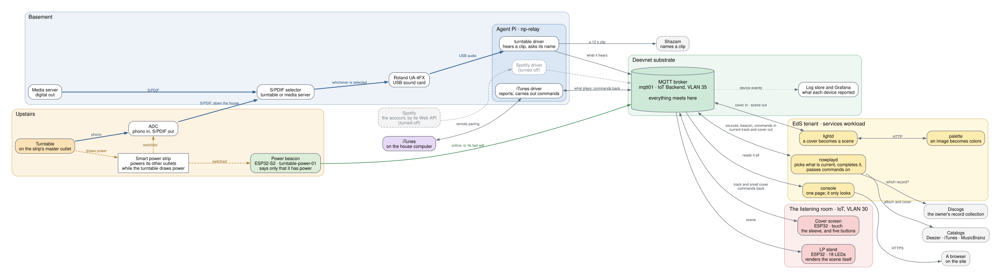

# Architecture

EdS is a collection of backend services, API integrations and
microcontrollers, all bound together by an MQTT messaging bus.

| | What | Where |
|---|---|---|
| **Backend services** | `nowplayd` decides what is playing and completes it; `lightd` turns a cover into a light scene; `palette` finds the colors in an image; the console is the page a person looks at | one workload in the EdS tenant |
| **Drivers** | one small program per source of music, each reporting what its player is doing | an agent Pi in the basement |
| **API integrations** | a recognizer that names a clip of sound; Discogs for the owner's record collection; Deezer, iTunes and MusicBrainz for albums and covers; Spotify for an account | other people's services |
| **Microcontrollers** | the LP stand and its light strip; the cover screen; a beacon that says the turntable has power | ESP32s in the house |

None of these talks to another directly. Each one publishes what it knows to
the broker and subscribes to what it needs, and almost everything published
is **retained**, so a program or a device that starts late finds the state of
the world waiting for it. That is what lets any one part be restarted,
reflashed or replaced without the others noticing.

## The system, as it is running

Read it left to right: where the music comes from, what hears it, the broker
where everything meets, and what acts on it. Select the picture to see it at
full size.

| Line | What it carries |
|---|---|
| Heavy blue | Sound: the record, as phono, then S/PDIF, then USB audio |
| Dashed amber | AC power, from the strip's switched outlets |
| Green | The beacon's one message: that it has power |
| Gray | Everything else, almost all of it MQTT through the broker |
| Dotted | Device events, on their way to the log store |

Gray boxes are someone else's service. A dashed box is turned off.

## A record, from power on to the lights

The turntable is the longest path through the system, and it touches every
part of it. This is what happens, in order.

### 1. The turntable is switched on

The turntable is plugged into the master outlet of a smart power strip, which
powers its other outlets only while the turntable draws power. Two things
come on with it: the converter that turns the record into S/PDIF, and the
**power beacon**, an ESP32 with nothing attached.

The strip and the converter are older than EdS. The house already sends one
digital feed to every room, and a selector in the basement hands that feed
to the turntable whenever the converter is sending. Switching the converter
with the turntable is how the selector knows a record is on
([Background: Sound Around the House](spdif/)). The beacon was added to the
same strip to learn the same thing, without touching the path the music
takes.

The beacon's connection is its message. It joins the WiFi, connects to the
broker and publishes `online`, retained, to
`eds/beacon/turntable-power-01/status`. It knows nothing about turntables;
`nowplayd` is told which source that beacon speaks for.

From that moment the turntable **holds the room**: `nowplayd` makes it the
current source before it has played a note, ahead of anything else that is
playing or paused
([ADR-0023](/docs/architecture/decisions/0023-a-source-that-is-switched-on-holds-the-stand/)).
This is why lifting the needle does not hand the lights to an iTunes left
paused in another room.

### 2. The record is heard

The sound goes from the converter down the house as S/PDIF, through a
selector it shares with the media server, and into a USB sound card on the
agent Pi. The **turntable driver** listens to that input all the time and
reports only what it is sure of
([ADR-0021](/docs/architecture/decisions/0021-the-turntable-is-identified-by-listening/)):

- silence is `stopped`;
- music it cannot name yet is `playing`, with no track.

That feed is there whether or not a record is on, which is why power and
sound are reported separately: the beacon says the turntable is on, the
driver says whether it is making music.

### 3. The song is named

While music plays, the driver cuts a twelve-second clip and hands it to a
**recognizer**, a small program that sends it to Shazam and prints a title,
an artist and an album. The driver knows only "a WAV in, a name out"; the
recognizer uses an endpoint nobody promised, and is the one file that would
change if it stopped working.

- The first answer after the needle comes down is believed alone.
- After that a different name needs two clips that agree, so one wrong
  answer does not repaint the room mid-song.
- A second of quiet followed by music is taken as the gap between two
  tracks: listening starts over and the next answer is believed alone
  again ([ADR-0026](/docs/architecture/decisions/0026-what-silence-means-on-the-turntable/)).

The driver publishes what it heard, retained, to its own source topic,
`eds/nowplaying/source/<id>/state`. It looks nothing up and has no cover to
send.

### 4. The record and its cover are found

`nowplayd` subscribes to every source and to the beacon, and publishes one
answer for everyone else: `eds/nowplaying/current`
([ADR-0008](/docs/architecture/decisions/0008-nowplayd-arbitrates-and-enriches/)).

A source that hears a track cannot know which record it is on: the same
song is on the album, a compilation and a box set. So for the turntable,
`nowplayd` asks the **owner's Discogs collection** first, and its answer
replaces the album the recognizer named
([ADR-0022](/docs/architecture/decisions/0022-the-owners-collection-names-the-record/)).
The sleeve comes from there too, so the picture is of the record actually
on the platter. If the collection does not have it, the catalogs are asked
in turn: Deezer, iTunes, MusicBrainz.

Then it publishes, all retained and in this order:

| Topic | What |
|---|---|
| `eds/nowplaying/current/look` | whether this album has a look of its own (step 6) |
| `eds/nowplaying/current/art` | the cover, as raw image bytes |
| `eds/nowplaying/current/art/small` | the same cover at 240 pixels, for a subscriber with little memory |
| `eds/nowplaying/current` | the track, the album, and the hash of the cover that belongs to it |

For the turntable, `current` also says there are no controls: a record
cannot be skipped from a screen
([ADR-0025](/docs/architecture/decisions/0025-current-says-when-there-are-no-controls/)).

### 5. The cover is taken apart

`lightd` subscribes to the cover topic and sees only image bytes; it never
learns the track or the album
([ADR-0009](/docs/architecture/decisions/0009-lightd-takes-covers-from-a-topic/)).
It posts the image to `palette` over HTTP.

`palette` converts the pixels to OKLab, drops the background (near-black,
near-white, near-neutral), clusters what is left, and returns ranked
swatches, each with its color, its share of the sleeve and how colorful it
is. It knows nothing about music, MQTT or LEDs, and the same cover always
gives the same answer.

### 6. The colors become a light pattern

`lightd` knows there is a strip on the other end, so the decisions that
need that knowledge are made here: it rejects swatches too gray to read as
a color, boosts saturation, and brings anything outside what the LEDs can
show back in without shifting its hue
([Layer Boundaries](boundaries/)).

The result is a **scene**: an effect by name, a speed, a brightness and a
short palette. `lightd` publishes it, retained, to
`eds/lightstand/<id>/scene`.

A few albums are lit by something other than their cover. `nowplayd` names
the look and `lightd` holds what it looks like; *The Dark Side of the Moon*
gets a spectrum
([ADR-0019](/docs/architecture/decisions/0019-an-album-can-have-a-look-of-its-own/)).

The **LP stand** receives the scene and animates it on its 18 LEDs itself.
It is never sent frames, so a network hiccup cannot make the lights stutter,
and a stand that reboots mid-album pulls the retained scene back down
instead of sitting dark
([ADR-0001](/docs/architecture/decisions/0001-device-renders-effects/)).

### 7. Everything else catches up

The same few messages drive the rest:

- **The cover screen** shows the small cover and the title. For the
  turntable it draws no buttons.
- **The stand** reports back what it is showing, on
  `eds/lightstand/<id>/state`.
- **The console** subscribes to all of it and serves one page: the track,
  the sleeve, the sources, the devices, and the strip drawn as the stand is
  drawing it. It only looks
  ([ADR-0018](/docs/architecture/decisions/0018-a-console-of-eds-own/)).
- **The devices and the agent Pi** send a few events each (boot, network,
  scenes, health) to `eds/log/<id>`, which Deevnet IoTaaS carries into the
  tenant's log store. Grafana reads them there
  ([ADR-0005](/docs/architecture/decisions/0005-device-events-over-mqtt/)).
- **Every call to an outside service is counted**, a minute at a time, and
  graphed on the Outside Services dashboard
  ([ADR-0027](/docs/architecture/decisions/0027-what-is-asked-of-outside-services-is-counted/)).

### 8. The music stops

After twenty seconds of silence the driver says `stopped`. `nowplayd` then
publishes `current` with no track and **empties** the cover topics, which is
the one way anything is told there is no cover
([ADR-0024](/docs/architecture/decisions/0024-paused-long-enough-is-not-playing/)).
`lightd` answers with its idle scene, dim and warm, and both screens drop
the sleeve. Turning a record over does this too; the cover and the lights
come back with the first track named on the other side.

When the turntable is switched off, the strip cuts the beacon's power. The
beacon cannot say goodbye, so the broker says it for it: its last will,
`offline`, about fifteen seconds later. The turntable stops holding the
room, and whatever else is playing takes it.

## iTunes

iTunes is asked, not heard. It runs on a computer on the home network, and
the agent Pi has a second network leg there to reach it
([ADR-0010](/docs/architecture/decisions/0010-home-lan-relay/)).

**What is playing.** The iTunes driver pairs with iTunes once, the way a
phone remote does, and from then on is told of every change as it happens,
with no polling
([ADR-0011](/docs/architecture/decisions/0011-itunes-by-remote-pairing/)).
It publishes the cover iTunes holds, then the state that names it. iTunes
knows its own album, so the Discogs collection is not asked; `nowplayd`
fills in only what is missing. From `current` onward the path is the one
above: cover, colors, scene, stand.

**Control.** iTunes is the one source that can be controlled, and there is
one route for it
([ADR-0020](/docs/architecture/decisions/0020-a-touch-screen-that-can-change-what-plays/)):

1. A button on the cover screen publishes a command, such as `next`, to
   `eds/nowplaying/command`. The screen does not know what is playing.
2. `nowplayd` passes it to the command topic of whichever source is
   current.
3. The iTunes driver carries it out over its pairing.

The commands are play or pause, next, previous, volume up and volume down.
A command is never retained: one the broker kept would be carried out again
by every program that connected afterward.

**Paused.** A track left paused for fifteen seconds is treated as nothing
playing: the cover goes and the stand idles. iTunes is still named as the
source, so pressing play on the screen resumes it.

## Spotify

Spotify is read from the account. A driver on the agent Pi asks Spotify's
Web API what the account is playing, every ten seconds, with read-only
permission
([ADR-0012](/docs/architecture/decisions/0012-spotify-by-web-api/)).

It differs from the other two in three ways, all on purpose:

- **The stand does not follow it.** Spotify's track is reported with no
  cover, and `nowplayd` neither publishes nor looks one up, so the room
  keeps the last sleeve it was lit from
  ([ADR-0016](/docs/architecture/decisions/0016-a-source-can-be-reported-without-its-cover/)).
- **It takes no commands.** The driver only reads. A button pressed while
  Spotify is current goes nowhere.
- **It is turned off for now.** Everything it needs is kept, and one setting
  on the Pi turns it back on
  ([CHG-0011](/docs/changes/2026/0011-spotify-turned-off/)).

## Where to go from here

- [The First Vertical](overview/): why the broker is not in the tenant, why
  the stand is never sent frames, why the scene is retained.
- [Layer Boundaries](boundaries/): which layer owns which color decision.
- [Background: Sound Around the House](spdif/): the whole-house audio
  system that was here first, and what EdS borrows from it.
- [Decisions](decisions/): every choice above, argued.
- [Now Playing](/docs/reference/now-playing/) and
  [MQTT Topics](/docs/reference/mqtt-topics/): the contracts, field by
  field.

The picture is drawn by GraphViz from `system.dot`, beside this page. Change
it there and run `make -C docs diagrams`; both files are committed, because
the site is built without GraphViz.
