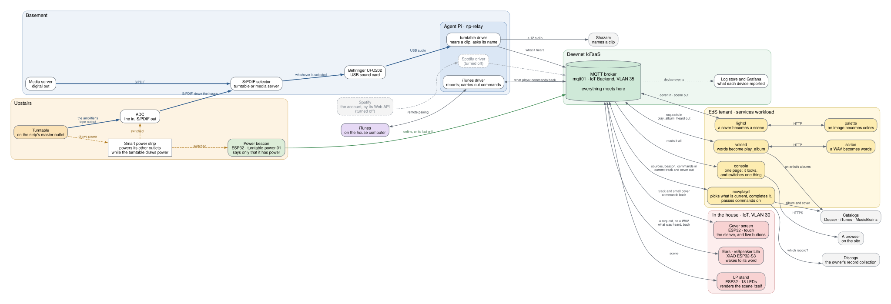

# Subsystems and Components

EdS is one system made of **subsystems**, and each subsystem is made of
**components**.

| Term | What it is | Example |
|---|---|---|
| **System** | EdS as a whole: everything here, and the bus it meets on | EdS |
| **Subsystem** | something a person in the room experiences from end to end, with a name of its own | the LP Light Show |
| **Component** | one program or one device, built, tested and deployed on its own | `lightd`, the LP stand |

A subsystem is named for what it does for a person, not for the parts it is
made of. The LP Light Show is a stand that glows in the colors of the
record; that it takes a Go service, a Python service and an ESP32 to do it
is the subsystem's own business.

Every component belongs to exactly one subsystem, or to the foundation they
all stand on. A component that seems to belong to two is usually two jobs in
one place, and is a sign that a boundary has been drawn in the wrong spot.

## The subsystems

| Subsystem | What a person sees | Components |
|---|---|---|
| [**Now Playing**](now-playing/) | nothing directly: it is what every other subsystem knows about the music | the drivers, the recognizer, the power beacon, `nowplayd` |
| [**LP Light Show**](lp-light-show/) | the LP stand lit in the colors of the record on the turntable | `lightd`, `palette`, the LP stand |
| [**Remote Display**](remote-display/) | a screen showing the cover, with buttons to pause, skip and set the volume | the cover screen |
| [**Voice Request**](voice-request/) | an album played because someone asked for it out loud | the ears, `voiced`, `scribe`, the library index |

Beneath them is the [**foundation**](#the-foundation): the broker, the
console, updates, logs, and where it all runs.

Each subsystem has a page of its own, with a picture of its components and
how a piece of music moves through them.

## The system, as it is running

Read it left to right: where the music comes from, what hears it, the broker
where everything meets, and what acts on it. Select the picture to see it at
full size.

| Line | What it carries |
|---|---|
| Heavy blue | Sound: the record, from the amplifier's tape output, then as S/PDIF, then as USB audio |
| Dashed amber | AC power, from the strip's switched outlets |
| Green | The beacon's one message: that it has power |
| Gray | Everything else, almost all of it MQTT through the broker |
| Dotted | Device events, on their way to the log store |

Gray boxes are someone else's service. A dashed box is turned off.

## The foundation

What every subsystem stands on, and that no subsystem owns.

- **The broker** (`mqtt01`, Deevnet IoTaaS's): where everything meets.
- **The console**: the page a person looks at, showing every subsystem at
  once
  ([ADR-0018](/docs/architecture/decisions/0018-a-console-of-eds-own/)). It
  subscribes to all of it and serves one page: the track, the sleeve, the
  sources, the devices, and the strip drawn as the stand is drawing it. It
  switches one thing: whether the stand is lit for records only or for
  every source
  ([ADR-0039](/docs/architecture/decisions/0039-the-console-can-light-the-stand-for-every-source/)).
- **Updates** (`eds-ota`): new firmware for every device, through the
  broker; a build that cannot reach the broker is undone
  ([ADR-0035](/docs/architecture/decisions/0035-firmware-is-updated-through-the-broker/)).
- **Events**: the devices and the agent Pi send a few events each (boot,
  network, scenes, health) to `eds/log/<id>`, which Deevnet IoTaaS carries
  into the tenant's log store, where Grafana reads them
  ([ADR-0005](/docs/architecture/decisions/0005-device-events-over-mqtt/)).
- **Counts**: every call to an outside service is counted, a minute at a
  time, and graphed on the Outside Services dashboard
  ([ADR-0027](/docs/architecture/decisions/0027-what-is-asked-of-outside-services-is-counted/)).
- **Where it runs**: the tenant's services workload, the agent Pi, their
  images and their deployment.

### Why the broker is not in the tenant

`mqtt01` lives on Deevnet IoTaaS's **IoT Backend** segment (VLAN 35), not on
a tenant VM, and the devices sit on the **IoT** segment (VLAN 30).

That placement is forced rather than preferred. MQTT clients always dial the
broker — the ESP32 initiates, never the reverse — so whichever segment holds
the broker must accept **inbound**. The tenant fabric has no inbound path by
design: Deevnet ADR-0003 delivered egress only, and Deevnet ADR-0001's
central promise is that the core router never learns tenant address space.
IoT Backend is the segment already defined to accept exactly this, with
`mqtt01` named in the model as its typical inhabitant.

Putting the broker on a tenant VM would mean inventing an inbound path to
tenant address space. That is an ADR, not a config change
([ADR-0003](/docs/architecture/decisions/0003-broker-is-the-substrates/)).

## How subsystems meet

Subsystems meet only where components do: at the broker, on topics. Nearly
all of it goes through Now Playing. The LP Light Show and the Remote
Display read what it publishes; the Remote Display and Voice Request send
it commands. No subsystem subscribes to another's internal topics, and none
knows another is there.

That is what lets a subsystem be added, changed or switched off without the
others noticing. The LP Light Show was running before the Remote Display
existed, and Voice Request was added without either of them changing.

## Adding a subsystem

A new subsystem starts with a name, for what it does for a person, a row in
the table above, and a page of its own beside the others, with its picture.
Then:

- Its components are its own. A component taken from another subsystem to
  save effort is a coupling that will have to be undone.
- It reads from Now Playing what it can, and asks for what is missing
  there, not by subscribing past it.
- What it needs from another subsystem that is not already offered on a
  topic is a decision to record first. So is a new command.

The pictures are drawn by GraphViz from the `.dot` file beside each page.
Change one there and run `make -C docs diagrams`; both files are committed,
because the site is built without GraphViz.
