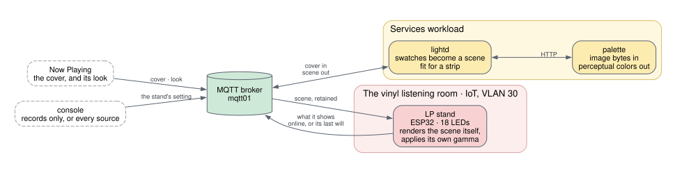

# LP Light Show

The first subsystem, and EdS's first idea of many: a record's cover becomes
the light on its stand. Prop the jacket on the LP stand and it is illuminated in
its own colors, set slowly moving, for as long as the record plays. It is
the first of what may be several light shows, which is why it is named for
the LP.

## Components

- **`lightd`**, on the services workload: takes the cover from Now Playing,
  asks `palette` for its colors, makes them fit for a strip, and sends the
  stand a scene.
- **`palette`**, on the services workload: image bytes in, colors out. It
  knows nothing of music or of LEDs.
- **The LP stand**: an ESP32 and 18 LEDs, animating the scene on its own.

How the three divide the color decisions is in
[Layer Boundaries](/docs/architecture/boundaries/).

## Outside services

None. Everything it needs comes from Now Playing, and `palette` and
`lightd` run on EdS's own workload.

## A cover, to the lights

### The cover is taken apart

`lightd` subscribes to Now Playing's cover topic and sees only image bytes;
it never learns the track or the album
([ADR-0009](/docs/architecture/decisions/0009-lightd-takes-covers-from-a-topic/)).
It posts the image to `palette` over HTTP.

`palette` converts the pixels to OKLab, drops the background (near-black,
near-white, near-neutral), clusters what is left, and returns ranked
swatches, each with its color, its share of the sleeve and how colorful it
is. The same cover always gives the same answer.

### The colors become a light pattern

`lightd` knows there is a strip on the other end, so the decisions that
need that knowledge are made here: it rejects swatches too gray to read as
a color, boosts saturation, and brings anything outside what the LEDs can
show back in without shifting its hue.

The result is a **scene**: an effect by name, a speed, a brightness and a
short palette. `lightd` publishes it, retained, to
`eds/lightstand/<id>/scene`
([Scene Descriptor](/docs/reference/scene-descriptor/)).

The palette is short, four colors at most, because a strip needs only a main
color for its ground and a few accents to play with. The effect is `chase`
unless something says otherwise: the main color holds the strip and each
accent travels around it.

Some sleeves still want work. One that is all white, all black, black and
white, or a single color leaves little to choose from, and how those should
be lit is not settled.

### The stand plays it

The **LP stand** receives the scene and animates it on its 18 LEDs itself,
applying the gamma curve its own driver and diffuser need. It reports what
it is showing on `eds/lightstand/<id>/state`.

## Some albums have a look of their own

A few albums are lit by something other than their cover. `nowplayd` names
the look and `lightd` holds what it looks like: *The Dark Side of the Moon*
gets a spectrum, and *American Idiot* the reds and pink of a clean scan of
its sleeve
([ADR-0019](/docs/architecture/decisions/0019-an-album-can-have-a-look-of-its-own/)).
One look belongs to a single track and is shown from any source: the theme
from *Knight Rider*, drawn as a red scanner
([ADR-0030](/docs/architecture/decisions/0030-a-piece-of-music-can-have-a-look-from-any-source/)).

## The stand is for records

For iTunes and Spotify, Now Playing publishes the cover with the look
`dark`, and `lightd` sends the stand dark
([ADR-0028](/docs/architecture/decisions/0028-the-stand-is-for-records/)).
The cover screen and the console still show that cover. The console can
switch the stand to light for every source, and back
([ADR-0039](/docs/architecture/decisions/0039-the-console-can-light-the-stand-for-every-source/)).
Lights of their own for what is not a record are meant for later.

When the music stops and the cover topics are emptied, `lightd` answers
with its idle scene, dim and warm, while the turntable is still switched
on, and dark once nothing is. Between dark and lit the strip opens from the
middle and closes to it; that is the stand's own and is never sent.

## Why the stand never receives frames

The stand subscribes to a **scene descriptor** and animates it locally at
its own rate. It is never sent pixel data
([ADR-0001](/docs/architecture/decisions/0001-device-renders-effects/)).

Streaming per-pixel frames over WiFi at any useful frame rate turns latency
spikes into visible stutter, and a broker outage would freeze an animation
mid-sweep. Rendering on the device means a stand whose network has gone away
keeps doing something sensible, and it keeps the payload small enough to
read by eye in `mosquitto_sub`.

## Why the scene is retained

Retention is load-bearing, not an optimization.

A stand that reboots — power blip, reflash, WiFi drop — pulls the current
scene down on reconnect instead of sitting dark until the next record.
Without it the failure mode is a black stand in the middle of an album.
Receiving the retained scene moments after subscribing is the normal case,
not an edge one.

There is an integration test for exactly this: it publishes, *then*
connects a subscriber, and requires the scene to arrive.

## When it cannot

The stand is dark until it is sent a scene. After twenty seconds without
the broker its first LED blinks red, a count a person can read without a
laptop: 1 for unprovisioned, 2 for no WiFi, 3 for no broker, 4 for a
refused login
([ADR-0029](/docs/architecture/decisions/0029-the-stand-starts-dark-and-blinks-what-is-wrong/)).
A scene it cannot read is ignored and the last one keeps playing.
