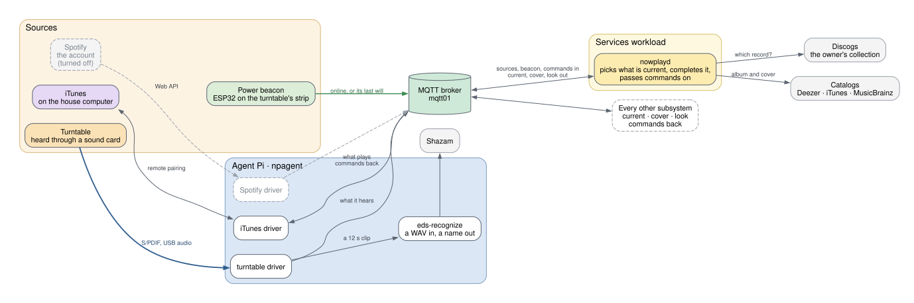

# Now Playing

Knowing what is playing is the one thing every other subsystem needs, so it
is a subsystem of its own and the others are built on it. It hears or asks
each source of music, decides which one is current, completes what it was
told, and publishes one answer for everyone else.

## Components

- **The drivers** (`npagent`, on the agent Pi): one for each source of
  music, iTunes, Spotify and the turntable, each reporting what its player
  is doing and carrying out commands where the player can take them
  ([ADR-0006](/docs/architecture/decisions/0006-now-playing-bus-of-drivers/)).
- **The recognizer** (`eds-recognize`): a WAV in, a name out, for the
  turntable driver.
- **The power beacon**: an ESP32 on the turntable's switched outlet, whose
  connection says the turntable is on.
- **`nowplayd`**, on the services workload: decides which source is
  current, names the record from the owner's collection, finds the cover,
  and publishes one answer for everyone else. It also routes every command
  to the source that should carry it out
  ([ADR-0008](/docs/architecture/decisions/0008-nowplayd-arbitrates-and-enriches/)).

## What it offers

The rest of EdS reads Now Playing from these topics, all retained and
published in this order:

| Topic | What |
|---|---|
| `eds/nowplaying/current/look` | whether this album has a look of its own |
| `eds/nowplaying/current/art` | the cover, as raw image bytes |
| `eds/nowplaying/current/art/small` | the same cover at 240 pixels, for a subscriber with little memory |
| `eds/nowplaying/current` | the track, the album, and the hash of the cover that belongs to it |

And one it takes: `eds/nowplaying/command`, never retained, which it passes
to whichever source is current. Field by field, these are in
[Now Playing](/docs/reference/now-playing/) and
[MQTT Topics](/docs/reference/mqtt-topics/).

One program decides so that everything agrees. The stand, the screen and the
console cannot differ about what is playing, because none of them works it
out. It also means each lookup is made once and not once per subscriber,
which keeps what EdS asks of other people's services small.

## Seen on the console

What Now Playing decides is shown on the console, the page a person looks
at: <https://console.eds.mobile.deevnet.net/>. It shows what is playing
whatever the source, a record, iTunes or Spotify, with its sleeve, and the
current status of the system around it: which sources are reporting and
what each is doing, which devices are online, and the stand's strip drawn as
the stand is drawing it. A device heard recently is shown green; one only
remembered by the broker is shown gray
([ADR-0034](/docs/architecture/decisions/0034-presence-is-heard-not-remembered/)).
The console itself belongs to the [foundation](../#the-foundation), since it
shows every subsystem.

## A record, from power on to silence

The turntable is the longest path through Now Playing. This is what
happens, in order.

### The turntable is switched on

The turntable is plugged into the master outlet of a smart power strip,
which powers its other outlets only while the turntable draws power. Two
things come on with it: the converter that turns the record into S/PDIF,
and the **power beacon**, an ESP32 with nothing attached. The strip and the
converter are older than EdS
([Background: Sound Around the House](/docs/architecture/spdif/)); the beacon
was added to the same strip to learn the same thing, without touching the
path the music takes.

The beacon's connection is its message. It joins the WiFi, connects to the
broker and publishes `online`, retained, to
`eds/beacon/turntable-power-01/status`. It knows nothing about turntables;
`nowplayd` is told which source that beacon speaks for.

From that moment the turntable **holds the room**: `nowplayd` makes it the
current source before it has played a note, ahead of anything else that is
playing or paused
([ADR-0023](/docs/architecture/decisions/0023-a-source-that-is-switched-on-holds-the-stand/)).
This is why lifting the needle does not hand the room to an iTunes left
paused in another room.

### The record is heard

A turntable has no data output. It cannot say what is on it; sound is all it
gives, so EdS listens.

The sound goes from the converter down the house as S/PDIF, through the
switch it shares with the media server, and into a USB sound card on the
agent Pi. The **turntable driver** listens to that input all the time and
reports only what it is sure of
([ADR-0021](/docs/architecture/decisions/0021-the-turntable-is-identified-by-listening/)):

- silence is `stopped`;
- music it cannot name yet is `playing`, with no track.

That feed is there whether or not a record is on, which is why power and
sound are reported separately: the beacon says the turntable is on, the
driver says whether it is making music.

### The song is named

While music plays, the driver cuts a twelve-second clip and hands it to the
**recognizer**, a small program that sends it to Shazam and prints a title,
an artist and an album. The driver knows only "a WAV in, a name out"; the
recognizer uses an endpoint nobody promised, and is the one file that would
change if it stopped working.

It was chosen because it costs nothing, which was enough to get the
turntable going. A paid service with a published API, or fingerprinting the
record locally and asking nobody, are both being considered for later.
Either would replace that one file and nothing else.

- The first answer after the needle comes down is believed alone.
- After that a different name needs two clips that agree, so one wrong
  answer does not repaint the room mid-song.
- A second of quiet followed by music is taken as the gap between two
  tracks: listening starts over and the next answer is believed alone
  again ([ADR-0026](/docs/architecture/decisions/0026-what-silence-means-on-the-turntable/)).

The driver publishes what it heard, retained, to its own source topic,
`eds/nowplaying/source/<id>/state`. It looks nothing up and has no cover to
send.

### The record and its cover are found

A source that hears a track cannot know which record it is on: the same
song is on the album, a compilation and a box set. So for the turntable,
`nowplayd` asks the **owner's Discogs collection** first, and its answer
replaces the album the recognizer named
([ADR-0022](/docs/architecture/decisions/0022-the-owners-collection-names-the-record/)).
The sleeve comes from there too, so the picture is of the record actually
on the platter. If the collection does not have it, the catalogs are asked
in turn: Deezer, iTunes, MusicBrainz.

Then it publishes the topics above. For the turntable, `current` also says
there are no controls: a record cannot be skipped from a screen
([ADR-0025](/docs/architecture/decisions/0025-current-says-when-there-are-no-controls/)).

### The music stops

After twenty seconds of silence the driver says `stopped`. `nowplayd` then
publishes `current` with no track and **empties** the cover topics, which is
the one way anything is told there is no cover
([ADR-0024](/docs/architecture/decisions/0024-paused-long-enough-is-not-playing/)).
Turning a record over does this too; the cover comes back with the first
track named on the other side.

When the turntable is switched off, the strip cuts the beacon's power. The
beacon cannot say goodbye, so the broker says it for it: its last will,
`offline`, about fifteen seconds later. The turntable stops holding the
room, and whatever else is playing takes it.

## iTunes

iTunes is asked, not heard. It runs on a computer on the home network, and
the broker is inside the Deevnet site, with no path between the two. So the
agent Pi stands in both: one leg at home, where iTunes can be found, and
one where the broker is
([ADR-0010](/docs/architecture/decisions/0010-home-lan-relay/)).

The iTunes driver pairs with iTunes once, the way a phone remote does, and
from then on is told of every change as it happens, with no polling
([ADR-0011](/docs/architecture/decisions/0011-itunes-by-remote-pairing/)).
It publishes the cover iTunes holds, then the state that names it. iTunes
knows its own album, so the Discogs collection is not asked; `nowplayd`
fills in only what is missing.

iTunes is the source that takes commands: play or pause, next, previous,
volume up and down from the [Remote Display](../remote-display/), and an
album by name from [Voice Request](../voice-request/). A track left paused
for fifteen seconds is treated as nothing playing; iTunes is still named as
the source, so pressing play resumes it.

## Spotify

Spotify is read from the account. A driver on the agent Pi asks Spotify's
Web API what the account is playing, every ten seconds, with permission to
read playback and to change it
([ADR-0012](/docs/architecture/decisions/0012-spotify-by-web-api/)).

It is shown as iTunes is
([ADR-0031](/docs/architecture/decisions/0031-spotify-is-shown-like-itunes/)):
the driver takes the album's picture from the same answer as the track.
Until 2026-10-13 it was reported with no cover at all
([ADR-0016](/docs/architecture/decisions/0016-a-source-can-be-reported-without-its-cover/)).
It differs from iTunes in these ways:

- **Its commands go by way of Spotify's servers**, not the home network
  ([ADR-0032](/docs/architecture/decisions/0032-spotify-takes-commands/)),
  and only for playback on a device that counts.
- **Only named devices count.** Playback elsewhere on the account, a phone
  in a car, is reported as stopped.
- **It is turned off**, for the calls it makes
  ([CHG-0024](/docs/changes/2026/0024-spotify-turned-off-again/)), as it
  was once before
  ([CHG-0011](/docs/changes/2026/0011-spotify-turned-off/),
  [CHG-0022](/docs/changes/2026/0022-spotify-shown-and-on-again/)).
