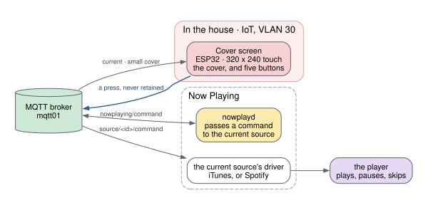

# Remote Display

A small touch screen that shows the cover of whatever is playing, and can
change it
([ADR-0020](/docs/architecture/decisions/0020-a-touch-screen-that-can-change-what-plays/)).
It is a stand-alone display and remote: for simple things, play or pause,
back and next, it is handier than the phone app, and it is a way to enjoy
the cover art in another room.

## Components

- **The cover screen**: an ESP32-2432S028R, a 320 by 240 touch panel with
  no external memory. It shows the small cover and the title, draws buttons
  when the source can take commands, sends what is pressed, and sleeps when
  nothing plays.

It is one component today. A second screen, or a remote of another kind,
would join it here; so would a portable screen with ears built in, which is
meant for later.

## What it shows

The screen reads two of Now Playing's topics, `current` and the cover at
240 pixels, `current/art/small`. A whole frame would not fit in its memory,
so nothing on it holds one: the cover is decoded a row of blocks at a time,
and the buttons are painted into each row as it passes. With no cover, it
shows a drawn record, its label lit while something plays.

## What a touch does

The cover is the screen; nothing is drawn over it until it is touched. The
first touch brings up five buttons: play or pause, previous, next, volume up
and volume down. The whole screen is a button, so a finger does not have to
find the icon. The buttons go away five seconds after the last touch.

A press goes one way, and it is the same for every controller:

1. The screen publishes a command, such as `next`, to
   `eds/nowplaying/command`. It does not know what is playing.
2. `nowplayd` passes it to the command topic of whichever source is
   current.
3. That source's driver carries it out: iTunes over its pairing, Spotify
   through its Web API.

A command is never retained, and the screen never queues one: a press
delivered after a reconnect would skip a track nobody asked to skip.

**When there is nothing to control, it offers nothing.** For a record,
`current` says there are no controls, and a touch does nothing
([ADR-0025](/docs/architecture/decisions/0025-current-says-when-there-are-no-controls/)).
The screen is told there is nothing to offer, not why: it knows no player,
and does not know the word "turntable".

## It sleeps when nothing plays

Five minutes after `current` last said something was playing, the panel
goes dark
([ADR-0036](/docs/architecture/decisions/0036-the-screen-sleeps-when-nothing-plays/)).
Playing wakes it, and so does a touch, which only wakes it. Losing WiFi or
the broker wakes it too, with a corner marked red or amber, so dark always
means asleep and never broken.
