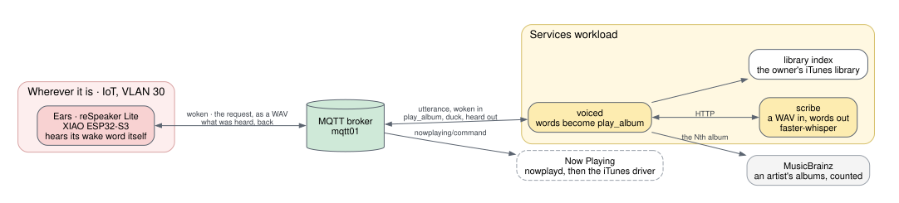

# Voice Request

An album played because someone asked for it out loud: "play Aerosmith's
first album", and it plays
([ADR-0042](/docs/architecture/decisions/0042-a-request-is-heard-on-the-workload/)).
It is in development: one device listens so far, and it sits wherever it is
being worked on. Ears are meant to be on several devices throughout the
house, or on one carried from room to room.

## Components

- **The ears**: a reSpeaker Lite running EdS's own firmware
  ([ADR-0043](/docs/architecture/decisions/0043-the-respeaker-runs-firmware-of-edss-own/)).
  Its XMOS chip cleans up what the room says; its XIAO ESP32-S3 listens for
  the wake word, keeps what follows, and sends it.
- **`scribe`**, on the services workload: a WAV in, words out, with
  faster-whisper. It knows nothing of music, as `palette` knows nothing of
  it.
- **`voiced`**, on the services workload: reads the words against a short
  grammar, counts an artist's albums when a place is named, chooses from the
  owner's library, and sends `play_album`.
- **The library index**: what the owner's iTunes library holds (artist,
  album, year, tracks), made from its XML and never committed
  ([ADR-0046](/docs/architecture/decisions/0046-requests-are-matched-against-the-owners-library/)).

## A request, from the word to the music

### 1. The ears wake

The ears listen for their wake word on the device itself, and send nothing
until they hear it. When they do, they say so on `eds/voice/<id>/woken`,
and keep what follows until the speaker stops, at most six seconds.

### 2. The music is turned down

On `woken`, `voiced` sends `duck` to whatever is current, and iTunes goes to
a quarter of its volume while the request is heard. It comes back on
`unduck`, once the request is answered, or by itself after ten seconds
([ADR-0044](/docs/architecture/decisions/0044-the-music-is-turned-down-while-a-request-is-heard/)).

### 3. The request is sent and written down

The ears send the request as one WAV, 16 kHz mono, on
`eds/voice/<id>/utterance`, never retained. `voiced` hands it to `scribe`
over HTTP and gets back words.

### 4. The words become an album

`voiced` reads the words with a short grammar: "play X's first album",
"play the Nth album by X", "play ALBUM by X".

- **An album named by its place** is counted among the artist's studio
  albums in MusicBrainz
  ([ADR-0041](/docs/architecture/decisions/0041-an-artists-nth-album-is-counted-in-musicbrainz/)).
  If the owner does not have that one, the next of the artist's albums that
  the library does have is played
  ([ADR-0045](/docs/architecture/decisions/0045-an-nth-album-not-owned-is-the-next-one-that-is/)).
- **With the library indexed**, the nearest artist and album it holds are
  chosen, so the request names titles iTunes has.
- **Words that are not a request** are said back as not understood. Nothing
  nearer is guessed.

### 5. The album plays

`voiced` publishes `play_album` to `eds/nowplaying/command`, like any
controller. `nowplayd` passes it to iTunes, whatever is current
([ADR-0040](/docs/architecture/decisions/0040-a-request-can-name-an-album-to-play/)),
and the iTunes driver plays the album by name. A miss is a failed command,
never a nearer guess.

`voiced` says what it made of the request on `eds/voice/<id>/heard`, and the
ears answer with their light: one long flash for an album asked for, three
short for not understood.

## What leaves the house

The wake word is heard on the ears; nothing is sent before it. The request
goes to EdS's own workload and is written down there, not by someone else's
service, and none of it is kept. What reaches MusicBrainz is an artist's
name, to count their albums.
